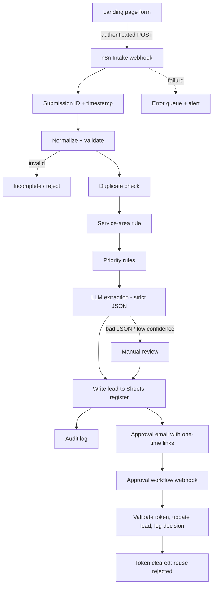

# Architecture

## Two workflows

| Workflow | Role |
|---|---|
| CanyonGlow Lead Intake and Triage | Receive, validate, classify, store, notify |
| CanyonGlow Lead Approval | Handle approve/reject links, update the register, audit |

## Trust boundaries

- **Deterministic:** validation, duplicates, service area, priority.
- **LLM:** summary, missing information, confidence, review reason only.
- **Human:** every high-priority, uncertain, outside-area or pricing/appointment message.
